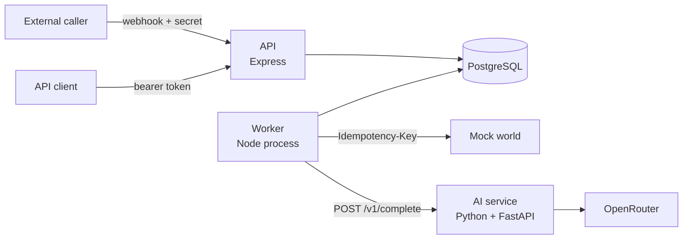
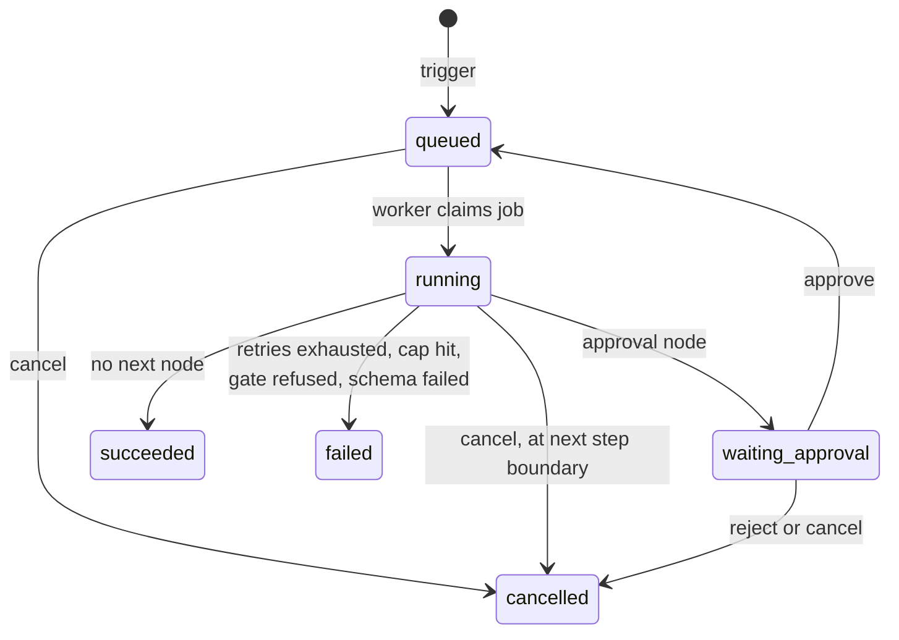

# Relay

An AI workflow orchestrator. Workflows are typed nodes, and AI can make decisions inside a run, but the engine controls what's allowed to happen. Runs survive crashes, side effects never repeat, and sensitive actions can't run without a human approval.

**Status:** the backend and console are complete, including configurable guardrails and triggers. Temporal integration isn't built yet. See [requirements.md](requirements.md) for the full design and [docs/VERIFICATION.md](docs/VERIFICATION.md) for test results.

## Architecture



| Folder | Contents |
|---|---|
| `docker-compose.yml` | Every service; see [Setup](#setup) |
| `frontend/` | React console |
| `backend/src/` | JavaScript: Express API and the engine |
| `backend/ai/` | Python: AI service, with no database access |
| `backend/contracts/` | JSON Schemas shared by JavaScript and Python |
| `backend/migrations/` | SQL migrations |
| `backend/pack/` | Airtribe data and scripts, unchanged |

### API layers

Each API follows the same path, and each layer only calls the one below it.

| Layer | Location | Responsibility |
|---|---|---|
| Route | `src/routes/` | URL, auth and validation wiring |
| Controller | `src/controllers/` | Reads the request, calls a service, shapes the response |
| Service | `src/services/` | Business rules and transactions |
| Repository | `src/repositories/` | All SQL |

## Setup

Relay always runs in Docker. You need Docker with Compose, `make` and `openssl`. The smoke test and drills also use `curl` and `python3`.

```bash
make run     # the first run creates .env and asks for OPENROUTER_API_KEY; run it again after adding the key
make status
make logs
make kill    # stops every container; data is kept
```

`make run` builds the images, starts every service, waits until they're healthy and opens the console at http://localhost:5173. Sign in with `ADMIN_EMAIL` and `ADMIN_PASSWORD` from `.env`. Use `make run OPEN_BROWSER=no` to skip the browser, and `make help` for every command. The API applies migrations and loads the seed workflows at startup.

If you'd rather not use `make`, copy `.env.example` to `.env`, fill in `JWT_SECRET`, `ADMIN_PASSWORD` and `OPENROUTER_API_KEY`, then run `docker compose up --build`.

| Service | Runs | Host port |
|---|---|---|
| `console` | React build served by nginx, which proxies `/api` to the API | 5173 |
| `api` | Express API | 8080 |
| `worker` | Engine and scheduler | None |
| `ai` | Python AI service | 8090 |
| `mock-world` | The pack's mock external system | 9210 |
| `postgres` | State and job queue, in the `relay-postgres` volume | 5544 |

Ports are published on `127.0.0.1` only. The worker shares the mock world's network because the seed workflows call `http://localhost:9210`, and the pack stays unchanged.

If Docker can't connect, your active context may be wrong. The Makefile uses the `default` context; override it with `make run DOCKER_CONTEXT=<name>`.

## Test

| Command | What it checks | Needs |
|---|---|---|
| `make test` | Lint and automated tests in containers, with fakes for external services | `make run` |
| `make smoke` | The pack's contract smoke test | `make run` |
| `make test-apis` | Every API live, including real OpenRouter calls | `make run` |
| `make drill` | Worker container killed with SIGKILL during a delay, resume, duplication check | `make run` |
| `make crash-drill` | Worker dies after a side effect, before saving it, then resumes | `make run` |
| `make test-all` | All of the above from a clean start | Nothing running |

Run the two drills while nothing else is executing. The duplication check flags any two identical sends, so another run on the same order looks like a duplicate.

## API

People sign in at `POST /auth/login` and get a JWT that lasts 8 hours. Platform routes need `Authorization: Bearer <JWT>`; scripts such as the smoke test can send `DEMO_TOKEN` instead. Webhooks need only `X-Relay-Secret`.

| Route | Purpose | Success |
|---|---|---|
| `POST /auth/login` | Sign in with email and password, no auth | 200 |
| `GET /auth/me` | Who is signed in | 200 |
| `GET /workflows` | List workflows | 200 |
| `POST /workflows` | Create a draft from a definition | 201 |
| `GET /workflows/{id}` | Read a workflow, secret masked | 200 |
| `PUT /workflows/{id}` | Update the working draft | 200 |
| `POST /workflows/{id}/publish` | Validate and freeze; returns `warnings` | 200 |
| `POST /workflows/{id}/trigger` | Manual trigger, body `{"input": {...}}` | 202 |
| `POST /hooks/{id}` | Webhook trigger; the body becomes the input | 202 |
| `GET /runs?workflowId=&status=` | Latest 100 runs | 200 |
| `GET /runs/{id}` | Run and full step trace | 200 |
| `POST /runs/{id}/cancel` | Cancel a run | 200 |
| `PUT /workflows/{id}/trigger` | Change the trigger; applies at publish | 200 |
| `POST /workflows/{id}/trigger/rotate-secret` | New webhook secret; the old one stops at once | 200 |
| `PUT /workflows/{id}/guardrails` | Change `limits` and `guardrails`; applies at publish | 200 |
| `GET /catalog` | Node types and params | 200 |
| `GET /sample-payloads?workflowId=` | Example inputs | 200 |
| `GET /approvals?status=pending` | List approvals; also `approved`, `rejected`, `closed` | 200 |
| `POST /approvals/{id}/approve` | Approve and resume | 200 |
| `POST /approvals/{id}/reject` | Reject and end the run | 200 |
| `GET /health` | Is the API up? No auth | 200 |
| `GET /ready` | Can it reach the database? No auth | 200 or 503 |

`GET /workflows`, `/runs` and `/approvals` take `limit` (1 to 200, default 100) and `offset`. Every response has an `X-Request-Id`, which also appears in the API log.

Errors look like `{"error": {"code": "...", "message": "..."}}`.

| Status | Meaning |
|---|---|
| 400 | Malformed request |
| 401 | Bad token or webhook secret |
| 404 | Unknown ID |
| 409 | Unpublished trigger, repeated decision, cancelling a finished run, or a webhook on a non-webhook workflow |
| 413 | Payload over the workflow's limit, 256 KB by default |
| 415 | Body isn't JSON |
| 429 | Over 300 webhook calls or 10 sign-ins a minute from one address |
| 422 | Invalid definition; `details` lists every problem |

## Configure guardrails and triggers

Settings live in a workflow's `limits` and `guardrails`, and apply at the next publish. Values outside the safe ranges are rejected with 422. [requirements.md](requirements.md) lists them all.

```bash
curl -X PUT localhost:8080/workflows/wf_expense_approval/guardrails \
  -H "Authorization: Bearer relay-demo-token" -H "Content-Type: application/json" \
  -d '{"guardrails": {"allowed_notify_targets": ["*@example.com"]}}'

curl -X POST localhost:8080/workflows/wf_expense_approval/publish \
  -H "Authorization: Bearer relay-demo-token"
```

## Run state machine



Every transition is a conditional database update, so illegal moves and double decisions fail.

## Exactly-once recovery

Exactly-once here means at-least-once delivery to an idempotent receiver.

1. **Before** a node runs, the step and its idempotency key are committed.
2. The node executes, sending that key on any side effect.
3. **After** it runs, the output and the next node are committed together.

If the worker dies, its job lease expires within 10 seconds and the restarted worker reclaims the job. It reads only persisted state: completed steps are skipped, and an unfinished step is re-sent with the same key, which the mock world absorbs if the first call landed.

The key is `{run_id}:{node_id}:{sequence}`. It has no attempt number, so retries and resumes reuse it. The sequence gives each loop iteration its own key.

## Design decisions

| Decision | Reason |
|---|---|
| Postgres as the queue | A run and its job are created in one transaction, so they can't drift apart |
| Separate worker process | Killing it leaves the API running, and execution never happens in a request handler |
| One step per claim | Long runs can't starve others, and delays and backoff don't block the worker |
| Python AI service with no database access | Nothing on the AI path can create an approval |
| Approval gate as a database query | No model output or prompt can satisfy it |
| Worker re-validates AI output | The engine doesn't rely on another service for its own guarantee |
| Failed runs from guard denials record no step | Refused nodes were never executed, and the run's error names them |
| Sensitive node with no approval only warns at publish | The engine refuses it at runtime, which is the stronger proof |
| Webhook secrets stored only as hashes | A database leak doesn't expose working secrets |
| Unclassified step errors end the run; database outages don't | Bad data can't retry forever, and an outage can't fail healthy runs |

**Patterns:** Strategy and Registry (node executors), Adapter (LLM provider), Repository and Unit of Work (data access), State Machine (run status), Chain of Responsibility (pre-step guards), Dependency Injection (wired in `api.js` and `worker.js`).

## Before a real production launch

The application handles failure, bad input and abuse as described above. These are deployment and business decisions it doesn't make for you:

- User management and roles, and removing the shared service token
- HTTPS, secret management and new database credentials
- Real integrations in place of the mock world
- Database backups, and a retention policy for traces
- Metrics and alerts, process supervision, and a load test

## Known limitations

- Two workers have been tested sharing the queue. Lease loss is covered only by automated tests.
- The run time limit excludes planned delays and time waiting for a human, but counts downtime. A run interrupted for longer than its limit fails with `timeout_exceeded` when it resumes.
- The token budget is checked before each AI step, so the last step can pass it slightly.
- A crash during an AI call repeats the call, and that attempt's tokens aren't recorded.
- One approval satisfies every gate for the rest of a run, as the catalog defines.
- Workflows have no input schema, so a payload missing `customer_email` fails at the notify step, after any earlier refund has run.
- The payload's `customer_email` isn't checked against the order. `pay_inject_001` uses an attacker's address, so approving it would email the attacker. The approvals API returns the raw payload so an approver can catch this.
- Injection flagging and redaction use patterns, which can be evaded and can over-redact. The guarantees come from the engine rules.
- `http_request` can only call the mock world and hosts in `OUTBOUND_ALLOWLIST`.
- Secrets placed in a workflow's `http_request` headers are masked in run traces, but still visible to anyone reading the workflow definition with the platform token.
- Each worker runs one step at a time, so a slow AI call delays other runs. Run more workers to avoid this.
- Approvals don't expire, and runs and traces are kept forever. Traces include prompts and raw AI responses, and prompts are sent to OpenRouter.
- The rate limit is held in each API process's memory.
- There's one admin account, created from `.env`, and no roles, so anyone signed in can approve. `DEMO_TOKEN` should be replaced or removed in a real deployment.
- A JWT can't be revoked before it expires, and sign-out only clears it from the browser.
